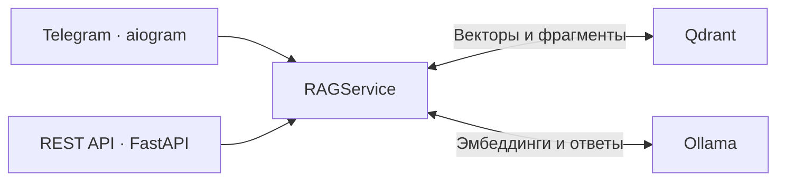

# AI Knowledge Assistant

[](https://github.com/tgmrv/ai-knowledge-assistant/actions/workflows/ci.yml)

Локальный RAG-ассистент по Markdown-документации. Он ищет нужные фрагменты в Qdrant и отвечает по ним через REST API или в Telegram. Бот также принимает `.md`-файлы и загружает их в общий индекс.

Для первого знакомства в репозитории есть [документация учебного интернет-магазина](docs/microservices_shop). Запускать сам магазин для демо не требуется.

## Быстрый старт

Понадобятся Git, Docker с Compose v2 и интернет для скачивания образов и моделей. Команды ниже рассчитаны на Bash или Zsh.

```bash
git clone https://github.com/tgmrv/ai-knowledge-assistant.git
cd ai-knowledge-assistant

docker compose up -d --wait qdrant ollama
docker compose exec ollama ollama pull qwen3-embedding:0.6b
docker compose exec ollama ollama pull qwen3.5:4b
```

Первая модель строит векторы для поиска, вторая формирует ответы. Обе работают локально через Ollama. Ключ от внешнего API языковой модели не нужен.

### Вариант 1. Попробовать API

Запусти пакетную индексацию демонстрационных документов и подними API. Папка `docs/` передаётся контейнеру только для чтения. Для этого варианта достаточно настроек по умолчанию.

```bash
docker compose run --rm --build -v "$PWD/docs:/app/docs:ro" api python -m app.ingest
docker compose up -d api
```

Дождись строки `Application startup complete` в выводе `docker compose logs -f api`, затем выйди из просмотра логов через `Ctrl+C`.

Открой [Swagger UI](http://127.0.0.1:8000/docs) или отправь вопрос из терминала.

```bash
curl -fsS http://127.0.0.1:8000/ask \
  -H 'Content-Type: application/json' \
  -d '{"question":"Сколько секунд Payment Service имитирует оплату?"}'
```

Пример ответа по демонстрационной документации.

```json
{"answer": "3 секунды."}
```

Если документы уже загружены через бота, начни с `docker compose up -d api`. Оба интерфейса читают один индекс.

### Вариант 2. Попробовать Telegram-бота

1. Создай бота командой `/newbot` у [@BotFather](https://t.me/BotFather) и получи токен.
2. Создай локальный `.env` из [шаблона](.env.example) и заполни два поля.

   ```bash
   test -f .env || cp .env.example .env
   ```

   | Переменная | Что указать |
   | --- | --- |
   | `TELEGRAM_BOT_TOKEN` | Токен нового бота от BotFather. |
   | `TELEGRAM_OWNER_ID` | Твой числовой ID пользователя Telegram. Он даёт право загружать документы. |

   Рабочий `.env` исключён из Git.

   <details>
   <summary>Как узнать свой Telegram ID</summary>

   Отправь новому боту `/start`. До запуска контейнера запроси обновления через [Telegram Bot API](https://core.telegram.org/bots/api#getupdates). Команда `read -rs` скрывает токен при вводе.

   ```bash
   printf 'Вставь токен бота и нажми Enter: '
   read -rs bot_token
   printf '\n'
   curl -fsS "https://api.telegram.org/bot${bot_token}/getUpdates"
   unset bot_token
   ```

   В ответе найди своё сообщение `/start` и возьми числовой ID из `message.from.id`.

   </details>

3. Запусти бота.

   ```bash
   docker compose up -d --build bot
   ```

4. В личном чате прикрепи файл [docs/microservices_shop/payment-service.md](docs/microservices_shop/payment-service.md) из клонированной папки или свой `.md` с текстом в UTF‑8. Несколько документов можно отправить по очереди.
5. Дождись сообщения «Файл … добавлен в поиск» и задай вопрос обычным сообщением. Для демо попробуй «Сколько секунд Payment Service имитирует оплату?».

Первая загрузка создаёт индекс. Повторная отправка файла с тем же именем обновляет его разделы в поиске без перезапуска.

## Как это устроено



1. При загрузке LangChain разбивает Markdown по заголовкам и длине. Сервис сохраняет в Qdrant текст фрагмента, его вектор, файл и раздел.
2. Для вопроса сервис строит вектор и находит до трёх ближайших фрагментов.
3. Ollama получает вопрос и найденный контекст и формирует текст ответа.

Модели и индекс живут в именованных томах Docker. После обычного `docker compose down` повторно скачивать модели и загружать документы не потребуется.

## Тесты и оценка поиска

Автотесты запускаются в [GitHub Actions](https://github.com/tgmrv/ai-knowledge-assistant/actions/workflows/ci.yml) при push и pull request. Локально их можно запустить с `uv` и Python 3.12. Запущенные Ollama, Qdrant и Telegram для тестов не нужны.

```bash
uv run --locked --python 3.12 --no-env-file pytest -q tests
```

После пакетной загрузки демонстрационных документов можно отдельно проверить поиск на [контрольных вопросах](evaluation/questions.json).

```bash
docker compose run --rm -v "$PWD/evaluation:/app/evaluation:ro" api python -m evaluation.evaluate
```

В контрольном прогоне `Hit@3` составил **7 из 7**. Для каждого вопроса проверялось, попал ли ожидаемый Markdown-файл в тройку найденных фрагментов. Это оценка поиска на уровне файлов.

**Пример разбора промаха.** На вопрос о падении Order Service после оплаты ассистент отвечал «Недостаточно данных». Нужный раздел отсутствовал даже в первых десяти результатах. После добавления [описания двух сценариев сбоя](docs/microservices_shop/rabbitmq-events.md) новый фрагмент занял второе место в пробном сравнении с исходной выдачей. С ним в контексте модель объяснила, когда заказ остаётся в `created`, а когда сохраняет статус `paid`.

## Что важно знать

- Задавать вопросы боту может любой пользователь, который напишет ему в личку. Право загрузки есть только у владельца. Используй демонстрационные или публичные документы, пока чтение не ограничено списком пользователей.
- Бот сохраняет содержимое загруженных файлов в Qdrant. Храни оригиналы `.md` отдельно, чтобы можно было заново собрать индекс из файлов.
- `ingest` обновляет найденные файлы, а удалённые с диска документы из индекса автоматически не исчезают. Если Telegram-файл совпадает по имени с файлом из корня `docs/microservices_shop/`, последняя индексация заменит предыдущую версию в поиске.
- Если ответ не приходит, проверь, что обе модели скачаны и хотя бы один документ загружен. Логи можно посмотреть через `docker compose logs --tail=100 bot` или `docker compose logs --tail=100 api`.
